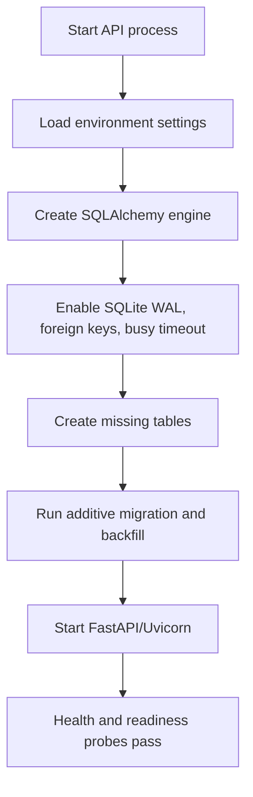
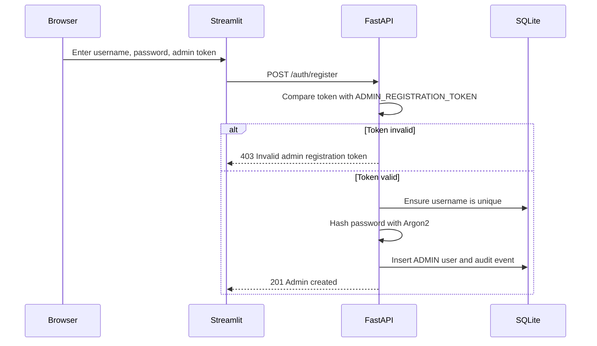
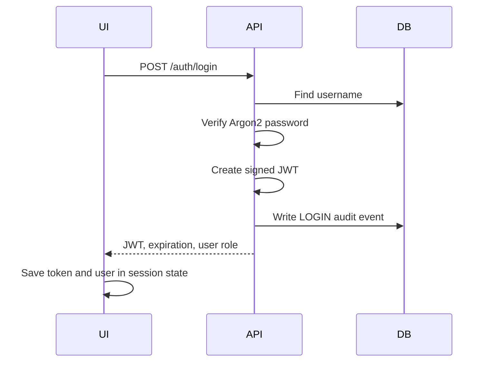
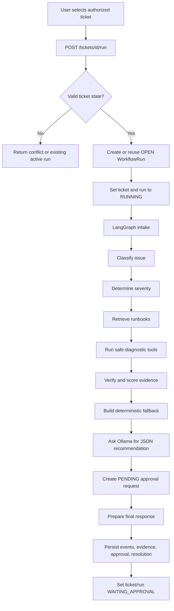
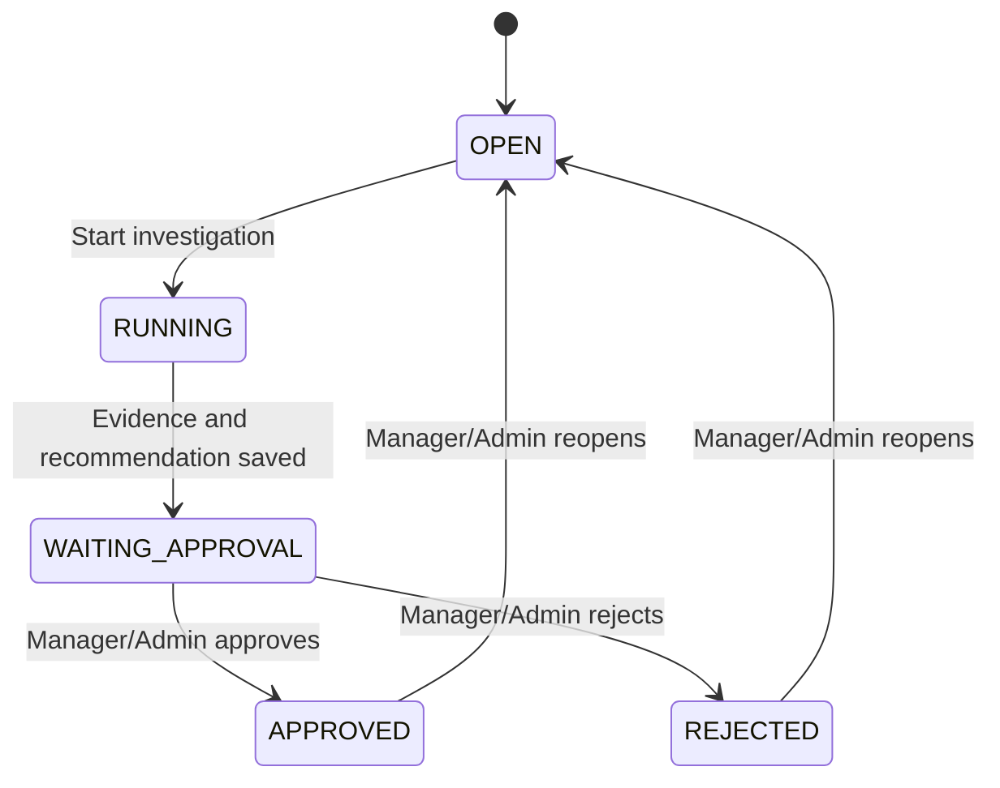
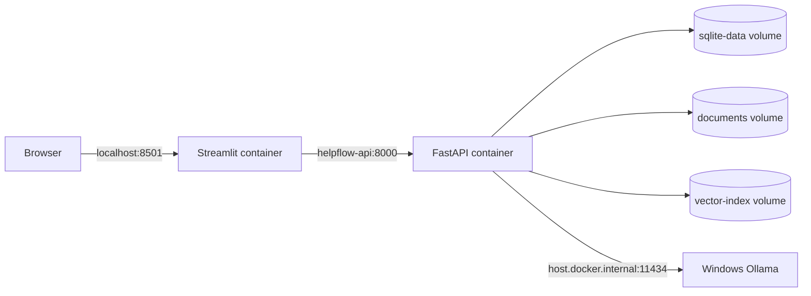
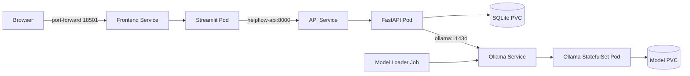

# HelpFlow: Complete File Guide and End-to-End Flow

This document explains the responsibility of every meaningful file in the HelpFlow project and then traces the complete runtime flow through the UI, API, authentication, database, agent workflow, Ollama, Docker Compose, and Kubernetes.

## 1. Project purpose

HelpFlow is a local, supervisor-led multi-agent IT-support application. It accepts support tickets and coordinates specialized Triage, Knowledge, Diagnostic, Evidence Verifier, Resolution, Policy, and Human Approval agents. The agents retrieve local runbooks, execute safe diagnostic tools, verify evidence, use local Ollama inference where appropriate, pause at a human approval gate, and preserve their complete execution history in SQLite.

The project is intentionally designed as a single-writer application:

- FastAPI provides the backend API.
- Streamlit provides the user interface.
- LangGraph runs the investigation state machine.
- Ollama provides local language-model inference.
- Chroma or keyword matching retrieves local runbooks.
- SQLite stores users, tickets, runs, evidence, approvals, resolutions, and audit logs.
- Docker Compose supports local container execution.
- Kubernetes supports a local Kind deployment with persistent storage and pod recovery.

## 2. Top-level directory map

```text
helpflow/
├── app/                         Backend application package
│   ├── agents/                  LangGraph and Ollama integration
│   ├── models/                  Pydantic API schemas
│   ├── rag/                     Runbook ingestion and retrieval
│   ├── tools/                   Safe mock diagnostic tools
│   ├── auth.py                  Passwords, JWTs, authentication, RBAC
│   ├── backup.py                SQLite backup and restore
│   ├── config.py                Environment-driven configuration
│   ├── database.py              SQLAlchemy models and migrations
│   └── main.py                  FastAPI application and endpoints
├── data/
│   ├── documents/               Local IT runbooks
│   ├── mock/                    Diagnostic fixture data
│   ├── backups/                 Generated local backups
│   ├── vector_index/            Generated Chroma index
│   └── helpflow.db              Host-mode SQLite database
├── frontend/
│   └── streamlit_app.py         Streamlit UI
├── k8s/                         Kubernetes manifests
├── scripts/
│   └── migrate.py               Schema migration command
├── tests/                        Automated tests
├── .env                         Local secrets and configuration
├── .env.example                 Safe configuration template
├── docker-compose.yml           Local multi-container deployment
├── Dockerfile.api               API production image
├── Dockerfile.frontend          Frontend production image
├── Dockerfile                   Legacy/all-in-one API-oriented image
├── requirements*.txt            Python dependencies
├── README.md                    Setup and operating instructions
├── PROJECT_OVERVIEW.md           Concise project overview
└── PROJECT_FILE_AND_FLOW_GUIDE.md This detailed guide
```

## 3. Root files

### `.env`

This is the active local environment file. It contains runtime values such as:

- Ollama URL and model name
- Database URL
- API URL
- JWT signing secret when configured
- Admin registration token
- Log level and CORS origins

It is excluded from Docker build context by `.dockerignore` because it can contain secrets. Docker Compose explicitly passes it to the API with `env_file`.

Important behavior:

- Docker Compose reads this file.
- Direct Python execution reads it through `pydantic-settings`.
- Kubernetes does not read this file directly. Kubernetes uses `k8s/configmap.yaml` and the `helpflow-secrets` Secret.
- Do not copy real secrets into source control.

### `.env.example`

This is a safe template that lists supported settings without containing real credentials. A new environment can copy it to `.env` and replace placeholder values.

### `.dockerignore`

This reduces Docker build context and prevents sensitive or generated content from entering images. It excludes:

- `.env`
- Git metadata
- Python caches
- Pytest cache
- SQLite database files
- Backups
- Vector indexes
- Test files
- README

The Dockerfiles explicitly copy only the source and seed data required by each image.

### `README.md`

This is the operational documentation. It covers:

- Local Python setup
- Ollama setup
- Docker Compose commands
- Kubernetes build/deploy commands
- Authentication and roles
- Backups and migrations
- Testing
- Troubleshooting
- Project limitations

### `PROJECT_OVERVIEW.md`

This is a shareable summary of the architecture, technologies, roles, deployment, and commands. It is shorter and less implementation-specific than this guide.

### `PROJECT_FILE_AND_FLOW_GUIDE.md`

This document. It is intended for onboarding, interviews, code walkthroughs, maintenance, and knowledge transfer.

### `requirements.txt`

This is the complete development dependency set. It includes backend, frontend, RAG, embedding, and testing packages.

Main packages include FastAPI, Uvicorn, Streamlit, SQLAlchemy, LangGraph, ChromaDB, sentence-transformers, PyJWT, Argon2, Pytest, and HTTP clients.

Use this file for a direct all-in-one Python development environment.

### `requirements.api.txt`

This contains only packages required by the API image:

- FastAPI and Uvicorn
- SQLAlchemy and Pydantic settings
- HTTPX
- LangGraph and langchain-core
- ChromaDB
- JWT and Argon2 security libraries
- Multipart and environment support

Keeping frontend and test packages out of the API image reduces its size and attack surface.

### `requirements.frontend.txt`

This contains only:

- Streamlit
- Requests

The frontend communicates with FastAPI over HTTP and does not access the database directly.

### `Dockerfile`

This is an older/general API-oriented image definition. It installs the full `requirements.txt`, copies `app/` and `data/`, and starts Uvicorn.

The current Docker Compose and Kubernetes flows use `Dockerfile.api` and `Dockerfile.frontend`, so this file is not the primary production path.

### `Dockerfile.api`

This builds the API image.

Key actions:

1. Starts from Python 3.11 slim.
2. Disables bytecode output and enables unbuffered logs.
3. Creates a non-root `helpflow` user with UID/GID `10001`.
4. Installs `requirements.api.txt`.
5. Copies backend code, runbooks, mock fixtures, and scripts.
6. Keeps seed data in both `/app/data` and `/app/bundled-data`.
7. Creates backup and vector-index directories.
8. Changes ownership to the non-root user.
9. Starts Uvicorn on port 8000 with one worker.

The fixed UID/GID matches the Kubernetes security context and volume permissions.

### `Dockerfile.frontend`

This builds the Streamlit image.

Key actions:

1. Starts from Python 3.11 slim.
2. Creates the same non-root UID/GID `10001`.
3. Sets a writable home directory for Streamlit.
4. Installs only frontend requirements.
5. Copies `frontend/`.
6. Exposes port 8501.
7. Starts Streamlit in headless mode.

### `docker-compose.yml`

This defines the local container deployment.

#### `helpflow-api`

- Builds from `Dockerfile.api`.
- Publishes host port 8000.
- reads `.env`.
- Overrides the Ollama URL to `http://host.docker.internal:11434`.
- Stores SQLite, backups, documents, and vector indexes in named volumes.
- Adds `host.docker.internal` routing on supported Docker engines.
- Uses `/health` for its Docker health check.
- Restarts unless manually stopped.

#### `helpflow-frontend`

- Builds from `Dockerfile.frontend`.
- Publishes host port 8501.
- connects to the API by Docker service DNS: `http://helpflow-api:8000`.
- waits for the API health check before starting.
- restarts unless manually stopped.

#### Named volumes

- `sqlite-data`: SQLite database and application data directory
- `backups`: generated backups
- `documents`: mutable runbook storage
- `vector-index`: Chroma index

Docker Compose does not run Ollama. Ollama runs on the Windows host.

## 4. Backend package: `app/`

### `app/__init__.py`

Marks `app` as a Python package so modules can be imported with names such as `app.main` and `app.database`.

### `app/config.py`

Defines the central `Settings` object using `pydantic-settings`.

Settings include:

- `APP_ENV`
- `DATABASE_URL`
- `OLLAMA_BASE_URL`
- `OLLAMA_MODEL`
- embedding configuration
- `JWT_SECRET_KEY`
- `ADMIN_REGISTRATION_TOKEN`
- token expiration
- CORS origins
- log level
- permanent log directory
- log timezone (`Asia/Kolkata` by default)
- data, backup, and RAG directories
- API rate limit

The module reads `.env`, ignores unknown values, and exposes `cors_origin_list`, which converts the comma-separated CORS setting into a list.

Every module imports the same `settings` instance, so configuration is consistent across the application.

### `app/logging_config.py`

Configures the `helpflow` application logger with two destinations:

- standard output, visible in the terminal, Docker logs, and `kubectl logs`;
- `data/logs/helpflow_YYYY-MM-DD.log`, permanent when the data directory is backed by a Docker volume or Kubernetes PVC.

`DailyDateFileHandler` selects the destination from each record's date. If the API stays running across midnight, it closes the previous file and begins appending to the new date's file automatically. Writes are flushed immediately so recent messages can be inspected during an incident.

### `app/database.py`

This file defines database connectivity, ORM tables, SQLite behavior, and additive migrations.

#### Engine configuration

- Creates the SQLAlchemy engine from `DATABASE_URL`.
- Enables `check_same_thread=False` for SQLite API access.
- Uses a 30-second connection timeout.
- Enables pool pre-ping.

#### SQLite connection pragmas

Every SQLite connection enables:

- WAL journal mode
- foreign keys
- a 30-second busy timeout

#### `SessionLocal`

This is the SQLAlchemy session factory used by API endpoints, authentication, workflow persistence, tools, and backups.

#### `UserRow`

Stores:

- username
- Argon2 password hash
- role
- active/inactive state
- created and updated timestamps

#### `TicketRow`

Stores:

- title and description
- service name
- priority and calculated severity
- lifecycle status
- creator user ID
- active workflow run ID
- timestamps

#### `WorkflowRunRow`

Stores each investigation attempt:

- UUID run ID
- ticket ID
- run status
- creator ID
- created, started, and completed timestamps

Reopening a ticket creates a new run instead of modifying an old run.

#### `EventRow`

Stores every workflow step event:

- ticket ID
- run ID
- workflow state name
- event type
- message
- JSON metadata
- creation timestamp

#### `EvidenceRow`

Stores verified evidence:

- ticket and run IDs
- source type
- source name
- content
- confidence score
- timestamp

#### `ApprovalRow`

Stores human approval records:

- ticket and run IDs
- requested action
- `PENDING`, `APPROVED`, or `REJECTED` status
- approver username
- decision reason
- timestamps

Approval decisions are treated as immutable after leaving `PENDING`.

#### `ResolutionRow`

Stores:

- root-cause hypothesis
- recommendation
- final response
- ticket and run IDs
- timestamp

#### `AgentExecutionRow`

Stores an auditable record for every Supervisor or specialist execution:

- ticket and immutable run IDs
- sequence number and agent name
- completion status
- structured input and output JSON
- whether Ollama was used and which model was selected
- execution duration and timestamp

#### `AuditLogRow`

Stores security and operational audit events:

- actor user ID
- action name
- resource type and ID
- JSON details serialized as text
- timestamp

#### Migration behavior

`Base.metadata.create_all()` creates missing tables. `migrate_schema()` adds missing columns without deleting data and backfills run IDs for older records.

The migration runs when the module is imported, which means API startup ensures the expected additive schema exists.

### `app/models/__init__.py`

Marks the models directory as a Python package.

### `app/models/schemas.py`

Defines Pydantic validation models used at the API boundary.

#### Role types

- `Role` allows Agent, Manager, or Admin where an existing user can be represented or patched.
- `ManagedRole` allows only Agent or Manager for `/users`, preventing Admin creation without the admin registration token.

#### `TicketCreate`

Validates title, description, service name, and priority. Input strings are stripped of surrounding whitespace.

#### `UserRegister`

Validates username, password, and `admin_token`. This endpoint always creates an Admin when the configured token matches.

#### `UserCreate`

Used by Admin User Management. It only accepts `SUPPORT_AGENT` or `SUPPORT_MANAGER`.

#### `UserPatch`

Allows role or active-state changes. The role field can represent all roles, while endpoint rules prevent unsafe self-deactivation.

#### Other schemas

- `LoginRequest`: login credentials
- `ApprovalDecision`: optional approval/rejection reason
- `Ticket`, `AgentEvent`, and `TokenResponse`: typed response structures available to the codebase

### `app/auth.py`

Implements password security, JWT authentication, and role dependencies.

#### Password functions

- `hash_password()` hashes passwords with Argon2.
- `verify_password()` safely checks a password and returns `False` on verification errors.

#### JWT secret behavior

- Uses `JWT_SECRET_KEY` when configured.
- Production refuses to operate without a configured secret.
- Development can use a generated in-memory secret.

#### `create_access_token()`

Creates an HS256 JWT containing:

- user ID in `sub`
- username
- role
- issue time
- expiration time

#### `get_current_user()`

1. Reads the bearer token.
2. Decodes and validates the JWT.
3. Loads the user from SQLite.
4. Rejects missing or inactive users.
5. Returns a detached user snapshot.

#### `require_roles()`

Produces FastAPI dependencies that enforce role-based access. Admin-only and Manager/Admin endpoints use this function.

### `app/backup.py`

Provides safe SQLite backup commands.

#### `create_backup()`

Uses SQLite's online backup API rather than copying a potentially active WAL database directly. It writes timestamped files into the backup directory.

#### `list_backups()`

Returns backups in newest-first order.

#### `restore_backup()`

Validates that the source is a `.db` file, runs `PRAGMA integrity_check`, and then copies it to the active database path.

#### Command-line interface

```powershell
python -m app.backup create
python -m app.backup list
python -m app.backup restore <backup.db>
```

### `app/main.py`

This is the central FastAPI application.

#### Application initialization

- Configures logging.
- Creates the FastAPI application.
- Adds CORS middleware.
- Defines a simple in-memory per-client rate limiter.

#### Request middleware

For every request, middleware:

1. Uses or generates an `X-Request-ID`.
2. Applies the per-minute request limit.
3. Measures processing time.
4. Converts unexpected exceptions into generic JSON errors.
5. Returns request ID and process-time headers.
6. Writes method, path, status, client, request ID, and duration to stdout and today's permanent log file.

#### Ticket authorization helpers

- Admin can access every ticket.
- Agent can access only tickets they created.
- Manager can access tickets created by Agents and Managers.
- Unauthorized ticket lookups return 404 to avoid leaking ticket existence.

#### Public operational endpoints

- `GET /`: service metadata
- `GET /health`: database health check
- `GET /ready`: readiness information

#### Authentication endpoints

- `POST /auth/register`: validates `ADMIN_REGISTRATION_TOKEN` and always creates an Admin
- `POST /auth/login`: verifies credentials and returns JWT plus user information
- `GET /auth/me`: returns the current authenticated user

Every new Admin must use the registration endpoint and token. `/users` cannot create Admin accounts.

#### User-management endpoints

- `POST /users`: Admin creates an Agent or Manager
- `GET /users`: Admin lists users
- `PATCH /users/{id}`: Admin changes role or active status

An active Admin cannot deactivate their own account through this endpoint.

#### Ticket endpoints

- `POST /tickets`: creates a ticket owned by the current user
- `GET /tickets`: returns the caller's authorized ticket scope
- `GET /tickets/{id}`: returns ticket details, runs, evidence, approvals, and resolutions
- `GET /tickets/{id}/runs`: returns workflow runs
- `GET /tickets/{id}/events`: returns workflow events
- `GET /tickets/{id}/agent-executions`: returns ordered Supervisor and specialist execution records

Ticket responses display the creator's username in `created_by` and role in `created_by_role`. The original numeric foreign key remains available as `created_by_id` for API compatibility and internal correlation.

#### Investigation endpoint

`POST /tickets/{id}/run`:

1. Verifies ticket access.
2. Rejects invalid lifecycle transitions.
3. Returns an existing active run when already waiting for approval.
4. Creates a UUID workflow run when required.
5. Marks the ticket and run `RUNNING`.
6. Commits that state before invoking the agent.
7. Calls `run_agent()` outside the initial database transaction.
8. On failure, marks the run `FAILED` and returns the ticket to `OPEN`.
9. On success, stores severity and changes the ticket/run to `WAITING_APPROVAL`.

#### Reopen endpoint

`POST /tickets/{id}/reopen` is available to Manager and Admin. It only accepts terminal tickets, creates a new open run ID, and preserves all old history.

#### Approval endpoints

- `POST /tickets/{id}/approve`
- `POST /tickets/{id}/reject`

Both require Manager or Admin. They only work while the ticket is `WAITING_APPROVAL` and the approval is still `PENDING`.

Approval records a decision; it does not execute a real external remediation action.

#### Administration endpoints

- `GET /audit-logs`: Admin-only audit history
- `POST /admin/backups`: Admin creates an online SQLite backup

## 5. Agent package: `app/agents/`

### `app/agents/__init__.py`

Package marker for agent modules.

### `app/agents/ollama.py`

Provides the Ollama HTTP integration through `ask_local()` and schema-validated multi-agent output through `ask_structured()`.

Flow:

1. If no valid model is configured, return the deterministic fallback.
2. POST to `/api/generate` with the configured model.
3. Request non-streaming JSON output.
4. Parse the model response as JSON.
5. Merge valid model fields over the fallback.
6. On timeout, HTTP error, or invalid JSON, return the fallback.

This design prevents a temporary Ollama issue from breaking the entire workflow.

### `app/agents/state.py`

Defines `MultiAgentState`, the shared investigation state. It carries the ticket, current and next agent, completed agents, supervisor cycle count, specialist outputs, tool results, evidence, approval, final response, and an in-memory agent trace.

### `app/agents/schemas.py`

Defines strict Pydantic output contracts for Triage, Diagnostic planning, Evidence Verification, Resolution, and Policy agents. Invalid or incomplete model JSON is rejected and replaced by a validated fallback.

### `app/agents/prompts.py`

Contains separate system instructions for each Ollama-assisted specialist. Prompts restrict responsibilities, require JSON output, and tell agents not to invent evidence or authorize sensitive actions.

### `app/agents/tracking.py`

Records every Supervisor and specialist execution in the state, workflow events, and `agent_executions` table. It captures sequence, input, output, Ollama usage, model name, and duration without storing credentials or JWTs.

### `app/agents/supervisor.py`

Implements bounded routing. The Supervisor examines completed work and triage requirements, chooses the next specialist, records every routing decision, and sends an incomplete workflow to manual review if its maximum cycle count is exceeded.

### `app/agents/triage.py`

Classifies issue type and severity, identifies the affected service, and selects required Knowledge and Diagnostic specialists. It uses Ollama structured output with deterministic keyword and priority fallback.

### `app/agents/knowledge.py`

Acts as the RAG specialist. It searches Chroma or the keyword fallback, stores retrieved documents, and reports document sources to the Supervisor.

### `app/agents/diagnostics.py`

Plans diagnostic calls using a strict allowlist, then safely executes service status, log search, runbook, and recent-incident tools. Unknown tools can never be executed.

### `app/agents/verifier.py`

Builds evidence from tool results and retrieved documents, evaluates sufficiency and confidence, lists missing evidence, and produces a cautious root-cause hypothesis.

### `app/agents/resolution.py`

Creates an evidence-bound technical recommendation and customer response, and declares whether a sensitive operational action is involved.

### `app/agents/policy.py`

Reviews resolution risk. The model cannot approve its own operation; sensitive actions are forcibly classified as requiring authorized human approval.

### `app/agents/human_approval.py`

Converts the reviewed policy action into a `PENDING` approval request. A Support Manager or Admin must make the final decision through the API.

### `app/agents/workflow.py`

Builds the LangGraph graph. Every specialist returns to the Supervisor through conditional routing. After Policy review, the Human Approval agent pauses remediation, `finalize_response` prepares the response, and `save_resolution` stores workflow events, evidence, approval, and resolution rows.

## 6. RAG package: `app/rag/`

### `app/rag/__init__.py`

Package marker for retrieval modules.

### `app/rag/ingest.py`

Builds the local Chroma index.

Flow:

1. Finds Markdown files in `data/documents`.
2. Creates the vector-index directory.
3. Opens a persistent Chroma client.
4. Creates or loads the `helpflow_runbooks` collection.
5. Upserts each document with filename and path metadata.
6. If indexing fails, records the error in `keyword-fallback.txt`.

Run manually with:

```powershell
python -m app.rag.ingest
```

### `app/rag/retriever.py`

Retrieves runbooks for the workflow.

Preferred path:

1. Open the persistent Chroma collection.
2. Query with ticket classification and description.
3. Convert distances into confidence scores.

Fallback path:

1. Split the query into lowercase terms.
2. Search Markdown file contents.
3. Score documents by matching meaningful terms.
4. Return the highest-scoring documents.

The fallback allows HelpFlow to work even when Chroma or an embedding model is unavailable.

## 7. Tools package: `app/tools/`

### `app/tools/__init__.py`

Package marker for tool modules.

### `app/tools/mock_tools.py`

Implements safe, local diagnostic tools backed by fixture files.

- `check_service_status()`: returns health and uptime from `system_status.json`.
- `search_logs()`: returns fixture logs for a service.
- `find_runbook()`: maps issue type to a Markdown runbook.
- `get_recent_incidents()`: returns historical fixture incidents.
- `create_ticket()`: lower-level database helper available as a mock tool.
- `draft_customer_response()`: prepares but does not send a response.
- `request_sensitive_action()`: always returns a PENDING human-approval request.

The main graph uses the status, log, runbook, incident, and sensitive-action tools. It does not execute real infrastructure changes.

## 8. Frontend: `frontend/streamlit_app.py`

This file contains the entire Streamlit UI.

### API communication

`api_call()`:

- Builds API URLs from `API_URL`.
- Adds the JWT bearer token from Streamlit session state.
- Uses a 90-second request timeout.
- Parses JSON errors.
- Clears login state on HTTP 401.
- Converts network errors into UI-friendly error objects.

### Shared helpers

- `show_api_error()`: displays API status and body.
- `select_visible_ticket()`: loads the scoped `/tickets` list and presents a dropdown.
- `load_ticket()`: retrieves detailed ticket information.

### Session state

Stores:

- JWT access token
- current user
- last run response
- latest created ticket

### Login and registration

- Login sends username/password to `/auth/login`.
- The Admin tab sends username/password/admin token to `/auth/register`.
- Registration always creates an Admin when the configured token matches.

### Role-aware sidebar

All users see ticket workflow pages. Only Admin sees:

- User Management
- Audit Log
- Backups

### Page responsibilities

#### Submit Ticket

Collects ticket fields, calls `POST /tickets`, and shows the created ticket ID.

#### Agent Investigation

Loads only tickets authorized for the current user, starts an investigation, manages terminal-ticket reopen actions, and presents approval controls to Manager/Admin.

#### Ticket History

Displays the scoped ticket list returned by the API. The single `Created By` column shows only the creator role (`ADMIN`, `SUPPORT_AGENT`, or `SUPPORT_MANAGER`). The internal numeric user ID and creator username are not displayed in this table.

#### Workflow History

Displays workflow runs, ordered multi-agent execution history, workflow events, and approval history for a selected ticket. Agent history includes the agent name, sequence, Ollama usage, duration, and structured output.

#### Evidence

Displays persisted diagnostic and document evidence.

#### Resolutions

Displays root causes, recommendations, and final responses.

#### User Management

Admin lists users and creates only Support Agent or Support Manager accounts. Admin creation is intentionally excluded so the registration token cannot be bypassed.

#### Audit Log

Admin displays immutable audit relcords.

#### Backups

Admin requests an online SQLite backup.

## 9. Data files

### `data/helpflow.db`

SQLite database used during direct host execution. Docker Compose uses its named volume, and Kubernetes uses its PVC, so those deployments have separate databases.

Do not copy a live WAL database casually; use the backup utility.

### `data/documents/api-500-errors.md`

Runbook for API HTTP 500 errors, dependency failures, request-ID correlation, safe rollback, and escalation.

### `data/documents/authentication-runbook.md`

Runbook for slow login and authentication failures.

### `data/documents/database-troubleshooting.md`

Runbook for database connection errors and pool exhaustion.

### `data/documents/escalation-policy.md`

General policy explaining when evidence, uncertainty, risk, or sensitive remediation requires escalation.

### `data/documents/incident-severity-guide.md`

Guidance for determining severity based on customer impact, scope, and duration.

### `data/documents/notification-service-runbook.md`

Runbook for delayed emails, provider limits, and queue backlog.

### `data/documents/payment-service-runbook.md`

Runbook for gateway timeouts, payment latency, retry storms, and provider escalation.

### `data/mock/system_status.json`

Fixture service status, uptime, and restart information used by `check_service_status()`.

### `data/mock/logs.json`

Fixture service logs containing timestamps, levels, messages, correlation IDs, and affected components.

### `data/mock/incidents.json`

Fixture incident history used by `get_recent_incidents()`.

### `data/backups/`

Generated timestamped SQLite backups. This directory is runtime data, not source code.

### `data/vector_index/`

Generated persistent Chroma files. This directory can be rebuilt from `data/documents`.

## 10. Migration script

### `scripts/migrate.py`

Adds the project root to Python's import path, creates missing tables, runs additive migrations, and prints a completion message.

Run with:

```powershell
python scripts/migrate.py
```

It preserves existing rows.

## 11. Test files

### `tests/conftest.py`

Creates a temporary test directory and sets environment variables before application imports.

Important isolation behavior:

- Uses a temporary SQLite database.
- Uses test-only JWT and Admin tokens.
- Disables Ollama by clearing the model.
- Raises the rate limit.
- Deletes the temporary directory after the test session.

This prevents tests from modifying real user tickets or accounts.

### `tests/test_helpflow.py`

Tests:

- mock diagnostic tools
- RAG retrieval
- sensitive-action approval requirement
- expected LangGraph nodes
- missing, invalid, and valid Admin registration tokens
- additional Admin registration
- prevention of Admin creation through `/users`
- Admin creation of Agents and Managers
- login and role authorization
- Agent ticket isolation
- Manager ticket scope
- Admin global ticket visibility
- workflow execution
- approval immutability
- reopening with a new run ID
- backup creation and listing

## 12. Kubernetes files

### `k8s/namespace.yaml`

Creates the `helpflow` namespace, isolating all HelpFlow resources.

### `k8s/kustomization.yaml`

Lists all deployable manifests and applies the `helpflow` namespace. `kubectl apply -k k8s` uses this file.

The secret example is intentionally not listed, preventing placeholder credentials from being deployed.

### `k8s/configmap.yaml`

Contains non-secret runtime configuration:

- production environment
- SQLite PVC database path
- cluster-local Ollama URL
- `llama3.2:3b` model
- logging
- CORS

### `k8s/secret.example.yaml`

Documents required secret keys:

- `JWT_SECRET_KEY`
- `ADMIN_REGISTRATION_TOKEN`

It is a template only. The actual Secret is created separately with `kubectl create secret`.

### `k8s/sqlite-pvc.yaml`

Requests a 5 GiB ReadWriteOnce volume for SQLite and related API data.

### `k8s/ollama-pvc.yaml`

Requests a 20 GiB ReadWriteOnce volume for Ollama models.

### `k8s/api-deployment.yaml`

Runs one API pod.

Important behavior:

- Uses `Recreate` to prevent two SQLite writers during updates.
- Runs as UID/GID 10001.
- Uses an init container to seed runbooks into the PVC without overwriting existing files.
- loads ConfigMap and Secret environment values.
- mounts the SQLite PVC at `/app/data`.
- defines liveness and readiness probes.
- applies CPU and memory requests/limits.

### `k8s/api-service.yaml`

Creates the cluster-local `helpflow-api:8000` DNS endpoint used by the frontend.

### `k8s/frontend-deployment.yaml`

Runs the Streamlit pod as UID/GID 10001.

It sets `API_URL=http://helpflow-api:8000`, defines Streamlit health probes, and applies resource limits.

Because the frontend is stateless, it can use a rolling update strategy.

### `k8s/frontend-service.yaml`

Creates the cluster-local `helpflow-frontend:8501` Service.

### `k8s/ollama-statefulset.yaml`

Runs one Ollama pod with stable name `ollama-0`.

It mounts the model PVC at `/root/.ollama`, exposes 11434, defines probes, and requests more CPU/memory than the application pods.

The StatefulSet recreates `ollama-0` after pod deletion while preserving downloaded models.

### `k8s/ollama-service.yaml`

Creates cluster DNS `ollama:11434`, which is used by the API and model-loader Job.

### `k8s/ollama-model-loader-job.yaml`

Runs once after deployment:

1. Waits until the Ollama Service responds.
2. Reads `OLLAMA_MODEL` from the ConfigMap.
3. Pulls that model into Ollama's persistent storage.
4. Finishes with `Completed` status.

`0/1 Completed` is normal for a finished Job.

### `k8s/ingress.yaml`

Defines an nginx route for host `helpflow.local` to the frontend Service.

The current Kind cluster reports the Ingress, but Windows access uses port-forwarding because Kind's port 80 is not mapped to the host.

## 13. Complete application flow

### 13.1 Startup flow



The frontend starts after the API is healthy in Docker Compose. Kubernetes starts both independently, then readiness probes control traffic.

### 13.2 Admin registration flow



Any Admin registration requires the configured token. Admin creation through `/users` is rejected by schema validation.

### 13.3 Agent/Manager creation flow

1. Admin logs in.
2. Admin opens User Management.
3. Admin chooses Agent or Manager.
4. UI sends `POST /users` with the JWT.
5. API checks the caller is Admin.
6. API hashes the temporary password.
7. API inserts the user and audit event.
8. The new user uses Login; they never use Register.

### 13.4 Login flow



Every protected request includes `Authorization: Bearer <JWT>`.

### 13.5 Ticket creation and visibility flow

1. Authenticated user submits title, description, service, and priority.
2. Pydantic validates lengths and priority values.
3. API creates an `OPEN` ticket with `created_by=current_user.id`.
4. API writes a `CREATE_TICKET` audit record.
5. Ticket appears according to scope:
   - Agent: own tickets only
   - Manager: Agent/Manager-created tickets
   - Admin: every ticket

The same access check is used for list, detail, runs, events, investigation, reopen, and decision paths.

### 13.6 Investigation flow



#### Failure behavior

If the graph raises an exception:

- the run becomes `FAILED`;
- the ticket returns to `OPEN`;
- `active_run_id` is cleared;
- an audit event records the failure type;
- the API returns a safe 502 response.

### 13.7 Retrieval flow

1. Classification plus description becomes the retrieval query.
2. Retriever attempts Chroma when a persistent index exists.
3. Chroma returns documents and distances.
4. Distances become confidence values.
5. If Chroma fails, keyword fallback searches Markdown files.
6. Selected document excerpts become evidence.

### 13.8 Diagnostic-tool flow

The graph calls tools through `_safe_tool()` so one tool failure does not crash all diagnostics.

Results include:

- current service status
- matching log entries
- mapped runbook
- recent incidents

Failures are stored in workflow event metadata.

### 13.9 Ollama flow

1. Workflow creates a fact-based fallback recommendation.
2. `ask_local()` calls Ollama `/api/generate` with JSON output requested.
3. A valid JSON object is merged over the fallback.
4. Invalid output, timeout, missing model, or connection failure returns the fallback.

The model does not directly execute tools or infrastructure commands.

### 13.10 Approval flow



Important rules:

- Agent cannot approve or reject.
- Decision requires `WAITING_APPROVAL`.
- Only a `PENDING` approval can change.
- A second decision is rejected.
- Approval records a decision but performs no real remediation.
- Reopen preserves the prior run and creates a new run ID.

### 13.11 History display flow

- Ticket History calls `GET /tickets`.
- Workflow History calls ticket detail and `/events`.
- Evidence reads persisted evidence from ticket detail.
- Resolutions reads persisted resolution records.
- Approval history shows every immutable decision across runs.

### 13.12 Backup flow

1. Admin clicks Create Backup.
2. UI calls `POST /admin/backups`.
3. API verifies Admin role.
4. `create_backup()` uses SQLite's online backup API.
5. Backup is written to persistent backup storage.
6. API writes an audit event.

## 14. Docker Compose runtime flow



Docker service DNS resolves `helpflow-api` only inside the Compose network. The browser never calls that DNS name directly.

## 15. Kubernetes runtime flow



### Kubernetes startup sequence

1. Namespace, ConfigMap, Services, PVCs, workloads, Job, and Ingress are applied.
2. Local API/frontend images are loaded into Kind.
3. PVCs bind through the default storage class.
4. API init container seeds runbooks.
5. API and frontend pass probes.
6. Ollama StatefulSet becomes ready.
7. Model-loader waits for Ollama and pulls `llama3.2:3b`.
8. Job becomes `Completed`.

### Kubernetes recovery

- Deleting an API pod causes its Deployment to create a replacement.
- Deleting a frontend pod causes its Deployment to replace it.
- Deleting `ollama-0` causes the StatefulSet to recreate it with the same stable name.
- SQLite and model data survive because they are in PVCs.
- Deleting the controlling Deployment, StatefulSet, namespace, or PVC is different and can stop workloads or remove data.

## 16. How code changes reach running environments

### Docker Compose

```powershell
docker compose up -d --build
```

### Kubernetes API change

```powershell
docker build -f Dockerfile.api -t helpflow-api:local .
kind load docker-image helpflow-api:local --name kind
kubectl rollout restart deployment/helpflow-api -n helpflow
kubectl rollout status deployment/helpflow-api -n helpflow
```

### Kubernetes frontend change

```powershell
docker build -f Dockerfile.frontend -t helpflow-frontend:local .
kind load docker-image helpflow-frontend:local --name kind
kubectl rollout restart deployment/helpflow-frontend -n helpflow
kubectl rollout status deployment/helpflow-frontend -n helpflow
```

### Kubernetes manifest change

```powershell
kubectl apply --dry-run=client -k k8s
kubectl apply -k k8s
```

ConfigMap environment changes require restarting the affected pod. A changed Ollama model also requires recreating the completed loader Job.

## 17. Data separation between run modes

| Mode | SQLite location | Daily API log location | Ollama location |
|---|---|---|---|
| Direct Python | `data/helpflow.db` | `data/logs/helpflow_YYYY-MM-DD.log` | Host Ollama |
| Docker Compose | `sqlite-data` named volume | `/app/data/logs/helpflow_YYYY-MM-DD.log` in `sqlite-data` | Host Ollama |
| Kubernetes | `helpflow-sqlite` PVC | `/app/data/logs/helpflow_YYYY-MM-DD.log` in `helpflow-sqlite` | Ollama StatefulSet and `ollama-models` PVC |

Users and tickets created in one mode do not automatically appear in another mode. Moving data requires a deliberate backup/migration operation.

The daily logger writes every request and application exception to stdout and the date-named file. Docker and Kubernetes therefore expose the same records through `docker compose logs` or `kubectl logs`, while the file copy survives container or pod replacement. Removing the named volume or PVC removes its stored log files as well.

## 18. Security boundaries

- Passwords are Argon2 hashes, not plaintext.
- JWTs are signed and expire.
- Admin registration requires a separate secret token.
- `/users` cannot create Admin accounts.
- Role authorization is enforced by the API, not only hidden in the UI.
- Ticket scope is enforced on direct ID endpoints.
- Unauthorized ticket access returns 404.
- Sensitive remediation remains paused for human decision.
- The project does not execute real external remediation.
- Containers run as non-root.
- Kubernetes service-account tokens are not mounted.
- Secrets are not included in Kustomize resources.

## 19. Operational limitations

- SQLite requires a single API writer.
- The in-process investigation occupies an API worker while running.
- The rate limiter is local memory and is not shared across replicas.
- Mock tools are fixtures, not real monitoring integrations.
- The deterministic classifier is keyword-based.
- CPU-only Ollama inference can be slow.
- Local Kind is for development and demonstration, not high-availability production.
- Local backups should be copied to protected external storage.

## 20. Short end-to-end summary

1. An Admin registers with the configured Admin token.
2. Admin creates Agent and Manager accounts.
3. A user logs in and receives a JWT.
4. The user creates a ticket.
5. Ticket visibility is filtered by role and ownership.
6. An authorized user starts the investigation.
7. LangGraph classifies, assigns severity, retrieves runbooks, and runs safe tools.
8. Evidence and a root-cause hypothesis are built.
9. Ollama improves a deterministic recommendation or the fallback is used.
10. A sensitive action is stored as PENDING.
11. Events, evidence, approval, and resolution are persisted.
12. Manager/Admin approves or rejects.
13. History remains immutable.
14. A terminal ticket can be reopened with a new run ID.
15. Docker or Kubernetes health management keeps the application running while persistent storage preserves data.
