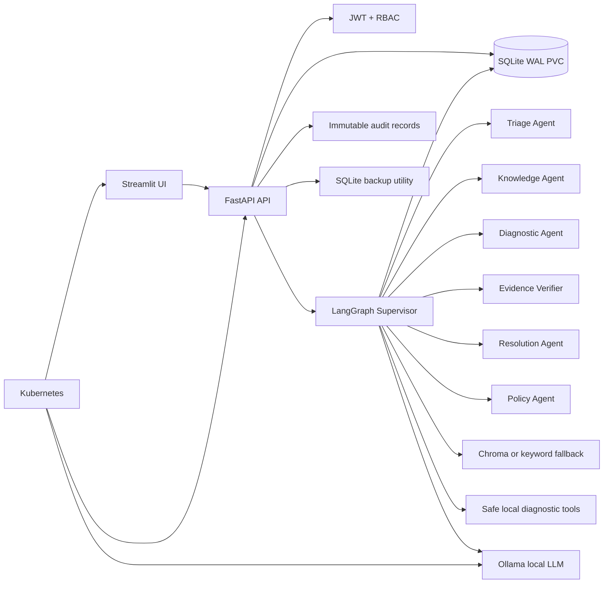
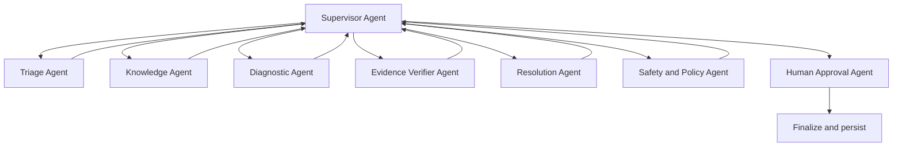
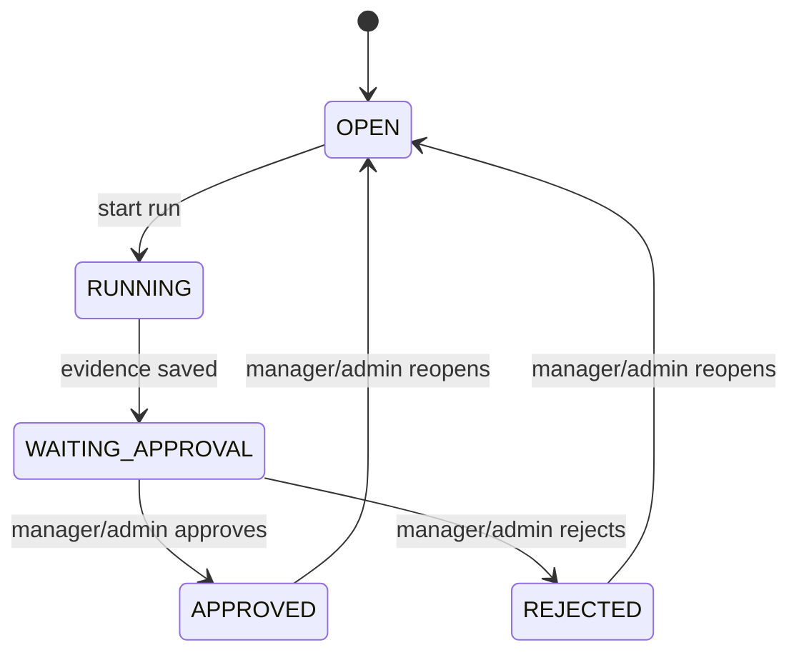

# HelpFlow

HelpFlow is a production-oriented, supervisor-led multi-agent IT support platform using local Ollama inference, SQLite persistence, RAG, LangGraph, Kubernetes health management, authentication, authorization, audit logging, backups, and human approval controls. It is deployed as a single API writer and is not designed for horizontal scaling without PostgreSQL and a durable work queue.

It accepts a ticket, classifies the issue, determines severity, retrieves local runbooks, calls safe mock diagnostic tools, verifies evidence, asks a local LLM for a recommendation, and pauses before sensitive action until an authorized human decides.

## Architecture



## Features

- Local Ollama model with a deterministic fallback when Ollama is unavailable.
- Supervisor-led LangGraph routing across Triage, Knowledge, Diagnostic, Evidence Verifier, Resolution, Policy, and Human Approval agents.
- Structured Pydantic outputs, approved-tool allowlists, deterministic fallbacks, and bounded supervisor cycles.
- Per-agent execution history including sequence, model usage, duration, inputs, and outputs.
- SQLite configured with WAL mode, foreign keys, busy timeout, persistent data, and additive migration support.
- JWT authentication with Argon2 password hashing.
- `SUPPORT_AGENT`, `SUPPORT_MANAGER`, and `ADMIN` roles.
- Immutable workflow runs and approval history.
- `OPEN -> RUNNING -> WAITING_APPROVAL -> APPROVED|REJECTED` lifecycle.
- Reopening creates a new run ID and preserves all previous records.
- Request IDs, structured logs, health/readiness probes, local rate limiting, and no stack traces in API responses.
- Chroma-backed local retrieval with keyword fallback.
- SQLite backup and restore commands.
- Docker Compose and Kubernetes manifests without PostgreSQL or Redis.

## Local setup

Use Python 3.11 or newer.

```powershell
cd "C:\Users\Lenovo\Documents\AI Projects\helpflow"
Copy-Item .env.example .env
python -m pip install -r requirements.txt
python scripts/migrate.py
python -m app.rag.ingest
```

Set a real local model in `.env`, for example a tool-capable model already installed in Ollama:

```env
OLLAMA_BASE_URL=http://localhost:11434
OLLAMA_MODEL=your-installed-local-model
JWT_SECRET_KEY=use-a-long-random-local-secret
ADMIN_REGISTRATION_TOKEN=use-a-separate-first-admin-token
LOG_DIR=data/logs
LOG_TIMEZONE=Asia/Kolkata
```

Start Ollama separately and verify it:

```powershell
ollama serve
ollama list
ollama pull your-installed-local-model
```

Start the API:

```powershell
python -m uvicorn app.main:app --host 127.0.0.1 --port 8000
```

Start the UI in a second terminal:

```powershell
streamlit run frontend/streamlit_app.py --server.port 8501
```

Open [HelpFlow](http://localhost:8501). Every registration creates an `ADMIN` account and requires `ADMIN_REGISTRATION_TOKEN`. Administrators create `SUPPORT_AGENT` and `SUPPORT_MANAGER` accounts from User Management, and those users only need to log in.

API documentation is available at [http://127.0.0.1:8000/docs](http://127.0.0.1:8000/docs).

## Authentication and authorization

Public endpoints are `/`, `/health`, `/ready`, `/auth/register`, and `/auth/login`. `/auth/register` always requires the configured `ADMIN_REGISTRATION_TOKEN` and always creates an `ADMIN` account, including additional administrators. Only an authenticated administrator can create support users through `/users`.

Role permissions:

- `SUPPORT_AGENT`: create tickets and view, investigate, and review evidence for only their own tickets.
- `SUPPORT_MANAGER`: view tickets created by support agents/managers, run investigations, and approve, reject, or reopen those tickets.
- `ADMIN`: view every ticket and access all permissions plus users, audit logs, and backups.

The UI provides separate pages for ticket history, workflow history, evidence, and resolutions. Ticket selectors are populated from the signed-in user's authorized ticket scope rather than requiring a manually entered ticket number.

The relevant endpoints are:

```text
POST /auth/register
POST /auth/login
GET  /auth/me
POST /users
GET  /users
PATCH /users/{user_id}
GET  /tickets/{ticket_id}/agent-executions
```

## Multi-agent investigation

The Supervisor Agent routes a ticket through specialized agents. Each specialist has a separate responsibility, input/output contract, and tool boundary. The same local Ollama model can support several logical agents; different models or Kubernetes pods are not required.



- **Supervisor Agent:** controls routing and enforces a maximum number of cycles.
- **Triage Agent:** classifies issue type, severity, service, and required specialists.
- **Knowledge Agent:** retrieves local runbooks through Chroma or keyword fallback.
- **Diagnostic Agent:** plans and executes only allowlisted local diagnostic tools.
- **Evidence Verifier Agent:** evaluates evidence sufficiency, confidence, and root cause.
- **Resolution Agent:** prepares an evidence-bound recommendation and customer response.
- **Policy Agent:** reviews risk and cannot authorize sensitive execution.
- **Human Approval Agent:** creates the pending action for Manager/Admin approval.

The Workflow History page displays the full agent execution sequence. Each execution is persisted in the `agent_executions` SQLite table and linked to the ticket and immutable run ID.

## Workflow state machine



`APPROVED` and `REJECTED` are terminal for that run. Decisions are immutable. Reopening creates a new run ID; it never modifies the prior run or approval record.

## Docker Compose

Compose runs only the API and frontend. SQLite, backups, documents, and the vector index use named volumes. Ollama remains outside Compose and is reached through `host.docker.internal`.

```powershell
Copy-Item .env.example .env
# Edit .env and set OLLAMA_MODEL and JWT_SECRET_KEY
docker compose up --build
```

Open:

- UI: http://localhost:8501
- API: http://localhost:8000
- API docs: http://localhost:8000/docs

Stop without deleting volumes:

```powershell
docker compose down
```

## Kubernetes

The manifests use one API replica and a `Recreate` update strategy because SQLite is not suitable for concurrent writers. Ollama uses a StatefulSet and persistent model storage. A Kubernetes Job automatically pulls the model configured by `OLLAMA_MODEL`. Kubernetes uses `http://ollama:11434`; `host.docker.internal` is never used inside the cluster.

Build local images:

```powershell
docker build -f Dockerfile.api -t helpflow-api:local .
docker build -f Dockerfile.frontend -t helpflow-frontend:local .

# Required for a local Kind cluster
kind load docker-image helpflow-api:local helpflow-frontend:local --name kind
```

Create the namespace and JWT secret:

```powershell
kubectl apply -f k8s/namespace.yaml
kubectl create secret generic helpflow-secrets `
  -n helpflow `
  --from-literal=JWT_SECRET_KEY='replace-with-a-long-random-secret' `
  --from-literal=ADMIN_REGISTRATION_TOKEN='replace-with-a-first-admin-token'
```

Validate and deploy:

```powershell
kubectl kustomize k8s
kubectl apply --dry-run=client -k k8s
kubectl apply -k k8s
kubectl get pods -n helpflow
kubectl get services -n helpflow
kubectl rollout status deployment/helpflow-api -n helpflow
kubectl rollout status deployment/helpflow-frontend -n helpflow
kubectl rollout status statefulset/ollama -n helpflow
kubectl wait --for=condition=complete job/ollama-model-loader -n helpflow --timeout=600s
```

Verify that the configured Ollama model is installed:

```powershell
kubectl get pods -n helpflow
kubectl get pvc -n helpflow
kubectl get jobs -n helpflow
kubectl exec -n helpflow ollama-0 -- ollama list
```

Update `k8s/configmap.yaml` with the exact model name before deployment. The included default is `llama3.2:3b`. CPU inference may be slow without GPU support.

Port-forward the UI and API:

```powershell
kubectl port-forward service/helpflow-frontend -n helpflow 18501:8501
kubectl port-forward service/helpflow-api -n helpflow 18000:8000
```

Open the Kubernetes UI at `http://localhost:18501` and API docs at `http://localhost:18000/docs`. The alternate host ports allow Docker Compose and Kubernetes to run at the same time.

Pod recovery demonstration:

```powershell
kubectl delete pod -n helpflow -l app=helpflow-api
kubectl get pods -n helpflow -w
kubectl logs -n helpflow deployment/helpflow-api
```

Kubernetes recreates the API pod through the Deployment. The SQLite PVC preserves the database across that restart.

## Permanent daily API logs

HelpFlow writes API runtime logs to stdout and to one permanent date-named file per day:

```text
data/logs/helpflow_YYYY-MM-DD.log
```

Each request entry includes its request ID, client address, HTTP method, path, response status, and duration. Errors include exception details in the same file. An API process that remains running across midnight automatically starts a new file for the new date.

The filename date and timestamps use `LOG_TIMEZONE`, which defaults to `Asia/Kolkata` and can be changed in `.env` or the Kubernetes ConfigMap.

For a local Python run:

```powershell
Get-Content .\data\logs\helpflow_$(Get-Date -Format yyyy-MM-dd).log -Tail 100 -Wait
```

Docker stores the directory in the persistent `sqlite-data` named volume:

```powershell
docker exec helpflow-api sh -c 'tail -n 100 -f /app/data/logs/helpflow_$(date +%F).log'
docker cp helpflow-api:/app/data/logs .\helpflow-logs
```

Kubernetes stores it in the `helpflow-sqlite` PVC:

```powershell
kubectl exec -n helpflow deployment/helpflow-api -- ls -l /app/data/logs
kubectl exec -n helpflow deployment/helpflow-api -- sh -c 'tail -n 100 /app/data/logs/helpflow_$(date +%F).log'
```

Docker and Kubernetes use separate persistent storage, so each deployment has its own log files. Deleting the Docker named volume or Kubernetes PVC also deletes the logs stored there.

## Migration and backups

Migration is additive and preserves the existing `data/helpflow.db` rows:

```powershell
python scripts/migrate.py
```

Backup commands:

```powershell
python -m app.backup create
python -m app.backup list
python -m app.backup restore data/backups/<backup-file>.db
```

The admin UI also exposes `POST /admin/backups`. Copy backups to protected storage; local files alone are not a disaster-recovery strategy.

## Tests and validation

```powershell
python -m pytest -q
docker build -f Dockerfile.api -t helpflow-api:local .
docker build -f Dockerfile.frontend -t helpflow-frontend:local .
kubectl kustomize k8s
kubectl apply --dry-run=client -k k8s
```

The test suite covers registration, login, invalid credentials, role authorization, ticket creation, workflow execution, duplicate run prevention, approval/rejection immutability, reopening, historical runs, RAG retrieval, backups, tool fixtures, and health endpoints.

## Troubleshooting

- `ModuleNotFoundError: No module named app`: run commands from the project root or use `python -m uvicorn app.main:app`.
- `404` from `/`: use the HelpFlow API at port `8000`, not another project already bound to that port.
- `401`: sign in through Streamlit and use the returned bearer token for protected API calls.
- Approval buttons are missing: the user is not `SUPPORT_MANAGER` or `ADMIN`.
- Ollama fallback is used: check `OLLAMA_BASE_URL`, `OLLAMA_MODEL`, `ollama list`, and API logs.
- Kubernetes API cannot start: create `helpflow-secrets`, build the local images, and check `kubectl describe pod -n helpflow`.
- Port already in use: stop the process/container or change the host-side port mapping.

## Known limitations and future migration path

This is a single-node production-oriented deployment. SQLite is durable and appropriate for a local or small internal installation, but it is not appropriate for horizontally scaled API replicas or high write concurrency. The in-process workflow also runs on the API worker; a larger deployment should move runs to a durable queue.

The next scale path is PostgreSQL for relational persistence, Redis or another durable queue for worker coordination, object storage for evidence/backups, a managed identity provider, and centralized observability. Those services are intentionally excluded from this project specification.

## Interview explanation

“HelpFlow is an agentic IT support workflow. A ticket enters a LangGraph state machine, which classifies the issue, retrieves runbooks, calls safe structured diagnostic tools, verifies evidence, and uses a local Ollama model to draft a recommendation. Sensitive actions stop at a human approval gate. Every run, event, evidence item, approval, and resolution is linked by a run ID and written to SQLite with audit logging. The deployment is single-node by design, with Docker and Kubernetes health management, persistent storage, authentication, RBAC, and backups.”

## Resume bullets

- Built a production-oriented agentic IT support platform using FastAPI, LangGraph, local Ollama inference, Chroma RAG, SQLite WAL persistence, Streamlit, Docker, and Kubernetes.
- Implemented JWT authentication, Argon2 password hashing, RBAC, immutable approval decisions, workflow run history, audit logs, request IDs, health/readiness probes, and safe local backups.
- Designed human-in-the-loop remediation controls where evidence-based recommendations require manager approval before any sensitive action; preserved historical runs during reopen and retry flows.
